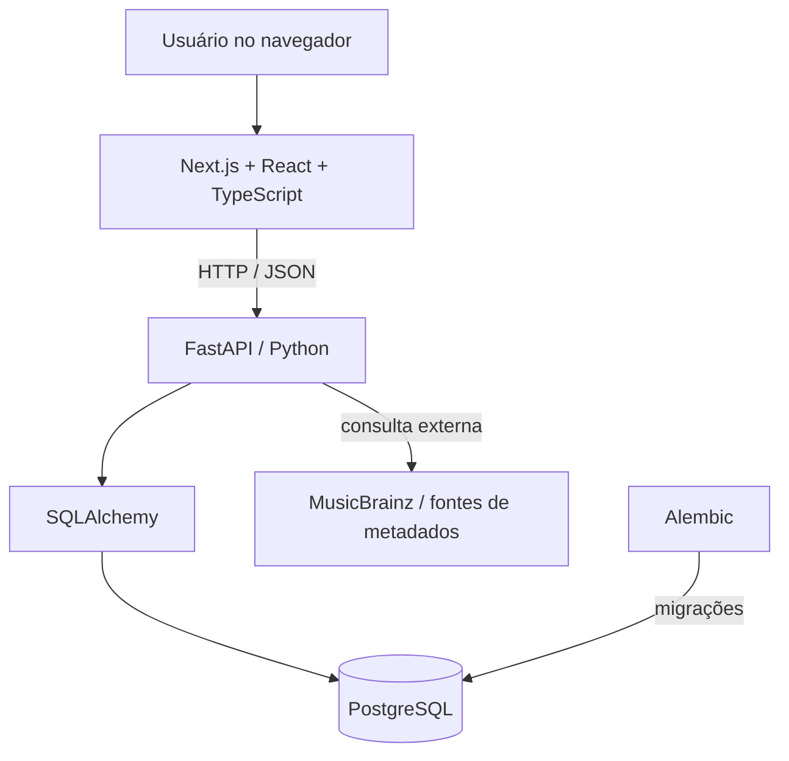

# Lettermusic — Arquitetura e regras V1

## Arquitetura escolhida



- **React:** componentes, eventos e apresentação de estados.
- **Next.js:** rotas, composição de páginas, renderização e recursos de servidor quando úteis. **Não criar outra API de domínio que replique o FastAPI.**
- **TypeScript:** tipos e contratos do cliente; não substitui validação no servidor.
- **CSS Modules:** estilos locais e consistentes com os mockups.
- **FastAPI:** autenticação e autorização, regras de negócio, validação e endpoints HTTP.
- **SQLAlchemy/Alembic/PostgreSQL:** persistência, alterações controladas no schema e integridade.
- **MusicBrainz:** catálogo externo; busca não deve persistir obra sem interação.

## Organização inicial recomendada (a ser criada, sem mover o que existe)

```text
PROJETO-MUSICAL/
├── backend/                # existente: API, regras, modelos, testes
├── alembic/                # existente se assim estiver no repo; manter localização real
├── frontend/               # futuro projeto Next.js
│   ├── src/
│   │   ├── app/            # rotas/páginas e layouts
│   │   ├── components/     # botões, cards, cabeçalho, estrelas
│   │   ├── lib/api/        # cliente HTTP, erros e funções de acesso ao FastAPI
│   │   ├── types/          # tipos de dados usados na interface
│   │   └── styles/         # tokens globais e tipografia
│   └── public/             # assets estáticos próprios/autorizados
├── docs/                   # documentação curta e atualizada
├── requirements.txt        # existente
└── README.md               # apresentação e instalação
```

Os caminhos são proposta inicial; antes de criar `frontend/`, conferir o repositório. Não duplicar modelos de negócio no Next.js.

## Fronteiras que queremos respeitar

- A página **solicita** “avaliar um álbum”; o FastAPI **decide** se a nota é válida e se a operação está autorizada.
- O front-end mostra dados e estados; o banco não pode ser acessado diretamente do navegador.
- Tipos TypeScript melhoram manutenção, mas o FastAPI/Pydantic continua validando requisições e respostas.
- Requisições públicas e privadas devem ser tratadas distintamente; jamais expor tokens, secrets ou credenciais em `NEXT_PUBLIC_*`.
- Se for necessário Next.js no servidor como intermediário (por segurança ou SEO), usá-lo como **camada fina**, sem regras duplicadas.

## Regras de negócio já decididas (preservar)

1. Busca no MusicBrainz **não** cria obra local; persistência após interação.
2. **“Já ouvi”** é único por usuário/obra; **escutas** são registros separados e podem ser múltiplas.
3. Criar avaliação ou review registra escuta; editar não gera escuta adicional.
4. Avaliação: de 0,5 a 5,0, em passos de 0,5; uma atual por usuário e obra, editável.
5. Uma review por usuário/obra, editável/removível.
6. Favoritos e Quero ouvir não significam escuta.
7. Listas públicas/privadas; proprietário controla mudanças e posição dos itens.
8. Dados privados não devem vazar em páginas públicas.

## Decisões técnicas já fechadas

| Tema | Decisão | Consequência |
|---|---|---|
| Front-end | Next.js App Router + React + TypeScript | Vite não será um projeto separado |
| Design | CSS próprio/Modules | Evitar componentes prontos com estética genérica |
| API de domínio | FastAPI | Não reescrever lógica em Next.js |
| Fluxo de trabalho | Integração vertical, uma ação por vez | Não criar primeiro oito páginas estáticas |
| Testes | Backend já coberto; acrescentar testes do frontend progressivamente | Escolher ferramentas/testes quando implementarmos fluxos |
| Infra pesada | Não introduzir sem necessidade medida | Sem microsserviços, Redis ou Kubernetes de início |

## Decisões a tomar somente quando o fluxo exigir

- **Autenticação web:** API hoje emite JWT via header `Authorization`; token expira e não há fluxo de refresh documentado. Antes do login do navegador, avaliar uma estratégia de sessão segura (por exemplo, cookie `HttpOnly` com camada fina de servidor no Next.js), proteção CSRF se usar cookies e expiração; **não fixar localStorage como padrão sem revisão**.
- **Renderização:** usar páginas públicas com renderização útil para compartilhamento/SEO onde trouxer benefício; interações privadas podem ser client-side. Não forçar Server Components em todas as rotas.
- **Dados/caching:** começar com `fetch` e funções em `lib/api`; acrescentar TanStack Query apenas se o estado e invalidação de cache justificarem.
- **Capas/faixas:** fonte consistente com MusicBrainz/Cover Art Archive; validar disponibilidade, direitos/termos e fallback. Evitar ilustrar dados faltantes com conteúdo fictício.
- **Perfis e imagens:** avatar de fallback inicial; upload de imagem só após fluxo de edição e infraestrutura adequados.

## Atenção de integração: CORS

No ZIP auditado, `backend/app/cors.py` permite por padrão `http://localhost:5173` e `http://127.0.0.1:5173` (porta típica Vite). **Next.js normalmente inicia em `http://localhost:3000`.** Antes de uma requisição direta do navegador ao FastAPI, ajustar `CORS_ORIGINS` localmente para incluir a origem real do Next.js, com teste e sem curinga. O middleware atual usa `allow_credentials=False` e JWT via header; se a estratégia de autenticação mudar para cookies cross-origin, a política terá de ser revisada conscientemente.

## Segurança, manutenção e desempenho

- Dados sensíveis em `.env` fora do Git e fora de ZIPs compartilhados. O ZIP anterior trouxe `.env`: não reutilizar esse padrão e considerar troca de segredos expostos.
- Paginação no servidor, tratamento de erros, timeouts e estados de carregamento/vazio no cliente.
- Evitar requisições duplicadas/sem controle ao MusicBrainz; pesquisar debounce/caching apenas quando a busca funcionar.
- Testes de regressão ao alterar API; revisar autenticação/autorização e dados privados.
- Cada entrega registra arquivos alterados, decisões, testes e caminho de rollback.
- Escalabilidade futura será medida por consultas, latência, uso e carga real, não inferida apenas da escolha de framework.
